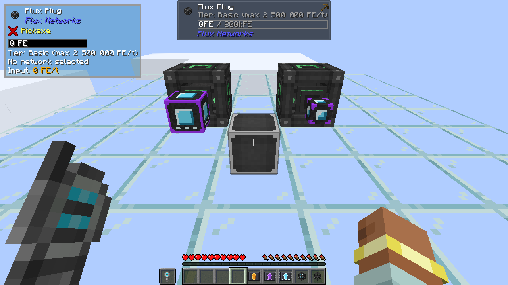

# Configuration

Flux Networks Extended has a single config file, on the server side and synced to the players. Its values are in FE per
tick.

## File

| Minecraft | Where |
|---|---|
| 1.21.1 (NeoForge) | `config/fluxnetworksextended-server.toml`. For one world only, copy it to `<world>/serverconfig/` and edit that copy. |
| 1.20.1 (Forge) | `<world>/serverconfig/fluxnetworksextended-server.toml`, created with each world. Modpacks put their defaults in `defaultconfigs/`. |

## Capping the basic devices

By default, Flux Networks' own Plugs and Points are untouched: existing networks keep working as before. A server that
wants the tiers to matter can turn on `capBasicDevices`: the basic devices then move at most `basicMaxLimit`
(2,500,000 FE/t by default), *Bypass Limit* included, and higher rates need the tiered devices.

- The limit stored in each basic device is kept: turning the cap off again restores it.
- Their GUI limit field stops at the cap, and [The One Probe and Jade](devices.md#the-one-probe-and-jade) show it.

## Why 10¹⁵ FE/t at most

Every limit in this file, and the Ultimate max limit, stops at 10¹⁵ FE/t. Flux Networks adds up the transfers of a
network in 64-bit numbers: devices with no limit on Mekanism creative energy cubes would overflow these sums and stop
the whole network ([reported upstream](https://github.com/SonarSonic/Flux-Networks/issues/595)). 10¹⁵ FE/t leaves room
for thousands of devices at full rate.

## Options

--8<-- "flux-networks-extended/server.md"
