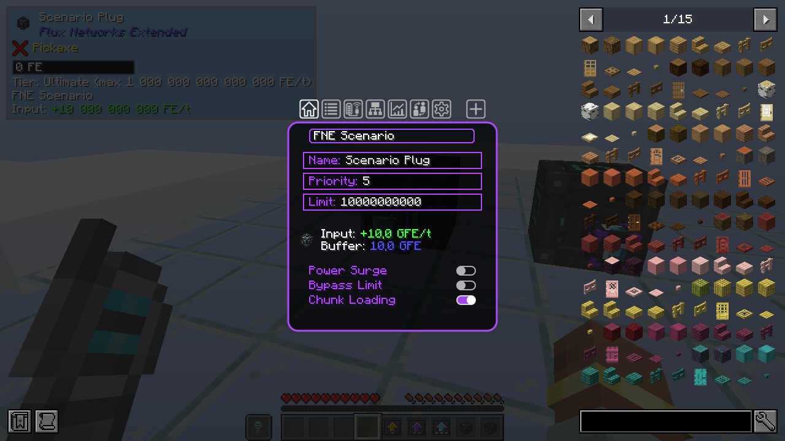

# Tiered Plugs and Points

Herculean, Gargantuan and Ultimate Flux Plugs and Points work exactly like Flux Networks' own: a Plug takes energy into
the network, a Point gives it out. They connect to any Flux Network, basic devices and Flux Storages included, and show
the network's colour. What changes is how much they can move per tick.

## Transfer limits

| Tier | Limit of a newly placed device | Max limit |
|---|---|---|
| Herculean | 5,000,000 FE/t | 20,000,000 FE/t |
| Gargantuan | 50,000,000 FE/t | 200,000,000 FE/t |
| Ultimate | 1,000,000,000 FE/t | 10¹⁵ FE/t |

- A device starts at its tier's default limit. Set any value up to the max limit in its GUI.
- **Bypass Limit** does not go past the tier: a Herculean Plug with *Bypass Limit* on still moves at most 20M FE/t.
- Both values are set per tier in the [server config](config.md). The Ultimate max of 10¹⁵ FE/t is also the highest
  value the config accepts: see [why](config.md#why-1015-fet-at-most).

## Crafting

Each tier is crafted from the tier below in the centre of a crafting table, Flux Networks' basic Plug or Point for the
Herculean tier:

| Result | Centre | 4 sides | 4 corners |
|---|---|---|---|
| Herculean Flux Plug / Point | Flux Plug / Flux Point | Flux Core | Diamond |
| Gargantuan Flux Plug / Point | Herculean Flux Plug / Point | Flux Block | Netherite Ingot |
| Ultimate Flux Plug / Point | Gargantuan Flux Plug / Point | Herculean Flux Storage | Nether Star |

The crafted device keeps the network of the one in the centre (on Minecraft 1.21.1, its settings too), as Flux
Networks does for its Flux Storages. To upgrade a device without picking it up, use an [upgrade kit](upgrade-kits.md).

!!! info "With Mekanism"
    When Mekanism is installed, these recipes are replaced by [Mekanism ones](mekanism.md#recipes).

All the devices and kits are in their own creative tab, *Flux Networks Extended*, next to Flux Networks' one.

## The device GUI

The GUI is Flux Networks' own, with a few changes for big numbers:

- The transfer limit field stops at the device's max limit instead of accepting any number.
- On tiered devices the field is labelled **Limit** instead of *Transfer Limit*, so that large values stay readable.
- The transfer and buffer lines switch to the compact form (10.0 GFE/t) when the full number would run out of the frame.

## The One Probe and Jade

Both are optional. Looking at a tiered Plug or Point shows its tier and max limit, for example
*Tier: Ultimate (max 1 000 000 000 000 000 FE/t)*, under Flux Networks' own information. The One Probe also shows
*Flux Networks Extended* as the mod name of tiered devices instead of *Flux Networks*.

When the [basic cap](config.md#capping-the-basic-devices) is on, Flux Networks' own Plugs and Points show it too:
*Tier: Basic (max 2 500 000 FE/t)*.

In Jade, the line can be turned off in the plugin settings: *Flux Plug and Point tier*.

The item tooltip of a device or kit shows the same tier and max limit.

## Breaking and wiping

- A broken device drops with its network and settings, like Flux Networks' own ones.
- To wipe the settings of a device, put it alone in a crafting grid, as for Flux Networks' devices.
