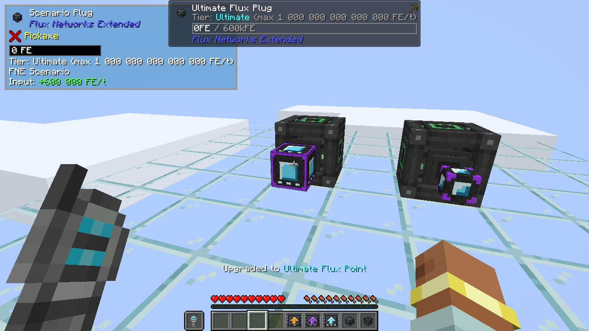

# Flux Networks Extended

{ align=right width="128" }

Un addon pour **[Flux Networks](https://www.curseforge.com/minecraft/mc-mods/flux-networks)** : des tiers supérieurs de
Flux Plugs et de Flux Points, des kits d'amélioration pour faire passer un appareil posé au tier suivant, et une
intégration Mekanism optionnelle.

!!! warning "Bêta"
    Les fonctionnalités sont complètes et testées, mais sauvegardez votre monde avant de mettre à jour et
    [signalez ce que vous trouvez](https://github.com/MrNesClick/MrNesClick-Mods/issues/new/choose).

## En bref

- **Trois nouveaux tiers**, nommés d'après les Flux Storages de Flux Networks : Flux Plugs et Points herculéens,
  gargantuesques et ultimes. Ils rejoignent n'importe quel réseau Flux comme ceux de base et en prennent la couleur.
- **Chaque tier a un plafond.** La limite de transfert d'un appareil s'arrête à la limite max de son tier,
  *Bypass Limit* compris.
- **Amélioration sur place.** Un clic droit avec un kit d'amélioration sur un Plug ou un Point posé : il passe au tier
  suivant et garde son réseau et tous ses réglages.
- **Mekanism (optionnel)** : les recettes utilisent les alliages et circuits de contrôle de Mekanism, et plus de
  2,1G FE/t passent par un seul Plug et un seul Point.
- **The One Probe et Jade (optionnels)** affichent le tier et la limite max de l'appareil regardé.
- **Configurable** : les limites de chaque tier, et un plafond optionnel des Plugs et Points de Flux Networks pour les
  serveurs qui veulent rendre les tiers nécessaires.

| Tier | Limite d'un appareil posé | Limite max |
|---|---|---|
| De base (Flux Networks) | 800 000 FE/t | inchangée, sauf [plafond](config.md#plafonner-les-appareils-de-base) |
| Herculéen | 5 000 000 FE/t | 20 000 000 FE/t |
| Gargantuesque | 50 000 000 FE/t | 200 000 000 FE/t |
| Ultime | 1 000 000 000 FE/t | 10¹⁵ FE/t |

## Pour aller plus loin

- [Plugs et Points de tier](devices.md) : recettes, limites de transfert, interface de l'appareil, sondes, effacement
  et démontage.
- [Kits d'amélioration](upgrade-kits.md) : améliorer un appareil posé sans le casser.
- [Intégration Mekanism](mekanism.md) : les recettes Mekanism et les transferts au-delà de 2,1G FE/t.
- [Configuration](config.md) : toutes les options, avec leur valeur par défaut.

## Prérequis

| Minecraft | Loader | Flux Networks | Optionnel |
|---|---|---|---|
| 1.21.1 | NeoForge 21.1.64+ | 8.x | Mekanism 10.7+, The One Probe, Jade |
| 1.20.1 | Forge 47+ | 7.2.1+ | Mekanism 10.4+, The One Probe, Jade |

Cet addon suit les versions maintenues par Flux Networks : quand Flux Networks se met à jour, cet addon aussi.

## Téléchargement

[CurseForge](https://www.curseforge.com/minecraft/mc-mods/flux-networks-extended) ·
[Signaler un bug](https://github.com/MrNesClick/MrNesClick-Mods/issues/new?template=1-flux-networks-extended-bug.yml)

Sans lien avec les auteurs de Flux Networks ou de Mekanism.
