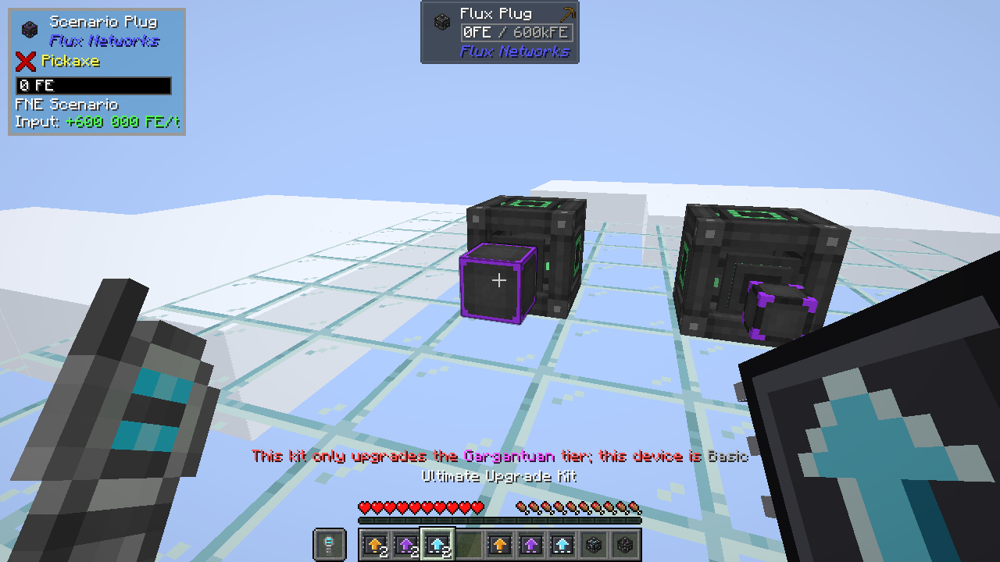

# Kits d'amélioration

Un kit d'amélioration fait passer un Flux Plug ou un Flux Point posé au tier suivant, sur place, sans le casser ni le
retirer du réseau.

| Kit | Améliore | En |
|---|---|---|
| Kit d'amélioration herculéen | Flux Plug, Flux Point (ceux de base de Flux Networks) | Herculéen |
| Kit d'amélioration gargantuesque | Flux Plug herculéen, Flux Point herculéen | Gargantuesque |
| Kit d'amélioration ultime | Flux Plug gargantuesque, Flux Point gargantuesque | Ultime |

## Utiliser un kit

Tenez le kit et faites un clic droit sur l'appareil posé. Il passe au tier suivant avec un son de table de forgeron et
le message *Amélioré en …*, et un kit est consommé (aucun en mode créatif).

L'appareil amélioré garde tout : son **réseau, son propriétaire, son nom, sa priorité, sa limite de transfert, Power
Surge, son tampon, ses connexions de faces et son chunkloading**.

Un kit ne fonctionne qu'un tier à la fois : passer du tier de base à l'ultime demande les trois kits dans l'ordre. Sur
un appareil d'un autre tier, rien ne change et un message indique le tier qu'il faut au kit :

Il faut avoir accès à l'appareil, comme pour ouvrir son interface : sur le réseau privé de quelqu'un d'autre, le kit
répond *Access denied: No permission* (un message de Flux Networks, en anglais).

## Recettes

Un kit coûte le même anneau de matériaux que la recette de l'appareil, avec le centre vide :

| Kit | 4 côtés | 4 coins |
|---|---|---|
| Kit d'amélioration herculéen | Flux Core | Diamant |
| Kit d'amélioration gargantuesque | Flux Block | Lingot de netherite |
| Kit d'amélioration ultime | Herculean Flux Storage | Étoile du Nether |

Avec Mekanism installé, les kits utilisent les [matériaux de Mekanism](mekanism.md#recettes), comme les appareils.
