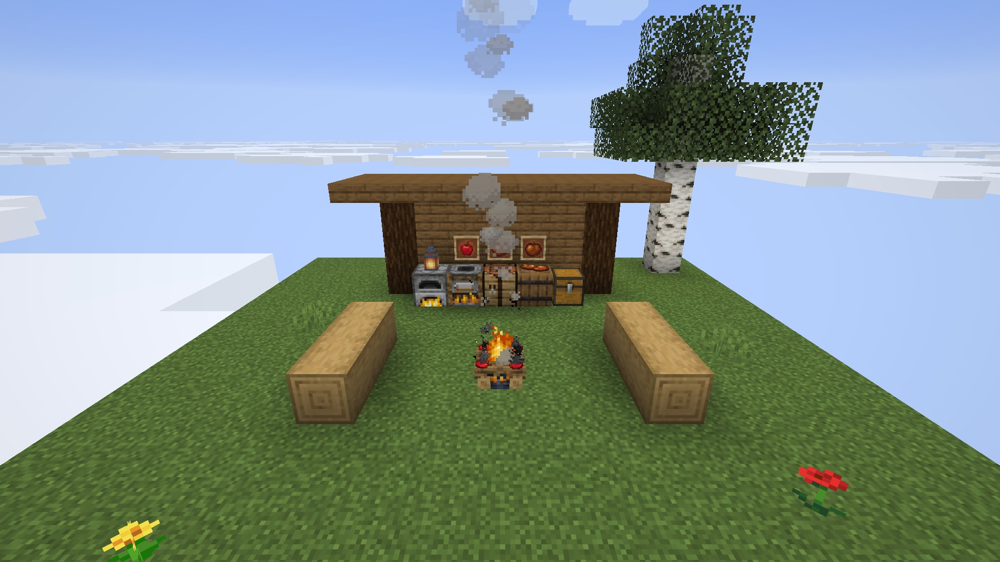
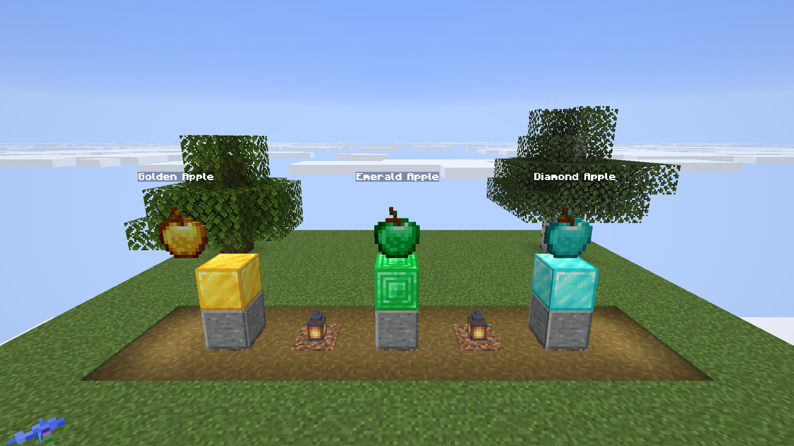
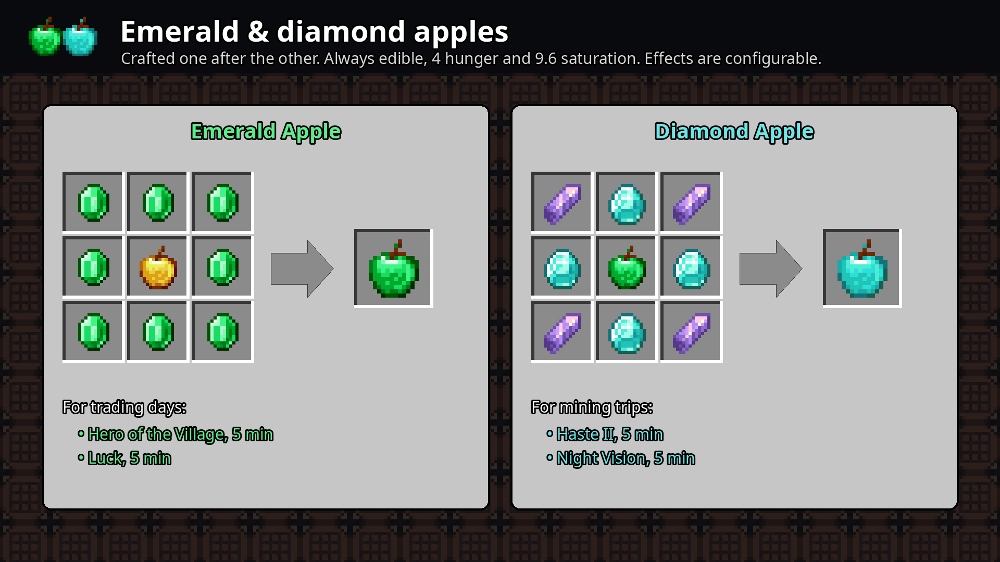
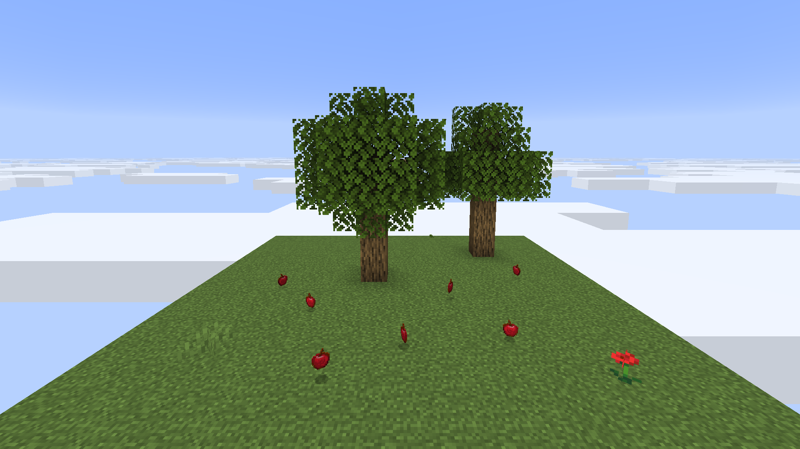

# Apples

Three new apples, and a say in how often leaves drop apples.

## Cooked apple

Cook a regular apple to get a **Cooked Apple**. It restores **8 hunger points (4 drumsticks)** and **12 saturation**,
much more than a raw apple (4 hunger, 2.4 saturation).

| Block | Time | XP | Enabled by default |
|---|---|---|---|
| Furnace | 10 s | 0.35 | yes |
| Smoker | 5 s | 0.35 | yes |
| Campfire | 30 s | 0.35 | yes |
| Blast furnace | 5 s | 0.35 | no: vanilla never cooks food in a blast furnace |

The cooked apple is in the *Food & Drinks* creative tab (*Foodstuffs* before Minecraft 1.19.3).



**Configurable** in [`[cooked_apple]`](config.md#cooked_apple): each cooking method, hunger and saturation.

## Emerald and diamond apples

Two apples crafted one from the other, with useful effects rather than a stronger golden apple. Both are always
edible, even with a full hunger bar, and restore 4 hunger and 9.6 saturation like a golden apple.

| Apple | Recipe (crafting table) | Effects |
|---|---|---|
| **Emerald Apple** | a golden apple surrounded by 8 emeralds | Hero of the Village and Luck, 5 minutes: eat it before a trading session |
| **Diamond Apple** | an emerald apple with 4 diamonds on the sides and 4 amethyst shards in the corners | Haste II and Night Vision, 5 minutes: eat it before a mining trip |

```
Emerald apple          Diamond apple
E E E                  A D A
E G E                  D M D
E E E                  A D A

E = emerald, G = golden apple, A = amethyst shard, D = diamond, M = emerald apple
```





**Configurable** in [`[emerald_apple]`](config.md#emerald_apple) and [`[diamond_apple]`](config.md#diamond_apple):
the recipe, hunger, saturation and the list of effects. Any effect works, modded ones too.

## Apples from leaves

In vanilla, only oak and dark oak leaves drop apples, 0.5 % of the time. MCNesclick keeps that by default, and lets you:

- change the chance for oak and dark oak leaves,
- let every other kind of leaves drop apples too (birch, spruce, jungle, acacia, cherry, mangrove, azalea, modded
  leaves…), with their own chance (0.25 % when turned on).

As in vanilla, leaves broken with shears or Silk Touch give no apples, and decaying leaves drop them too. Fortune still
increases the chance on oak and dark oak leaves.



**Configurable** in [`[apple_drops]`](config.md#apple_drops).
