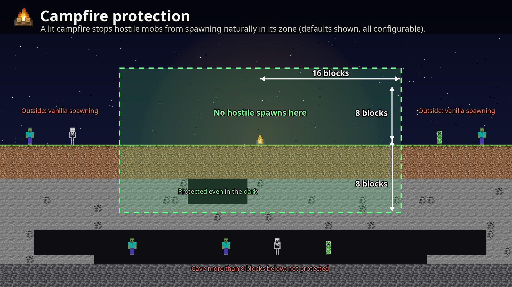

# Feu de camp protecteur

Un feu de camp allumé empêche les monstres d'apparaître naturellement autour de lui. Allumez-en un dans votre camp ou
votre base, et la nuit reste calme autour.

## La zone protégée

Par défaut, **16 blocs autour du feu de camp et 8 blocs au-dessus et en dessous**. La zone est plate exprès : un feu de
camp dans votre base ne protège pas tout le réseau de grottes en dessous.

## Ce qu'il bloque, et ce qu'il ne bloque pas

- Il bloque l'**apparition naturelle des monstres**, même dans les coins sombres de la zone.
- Les monstres qui **arrivent à pied** de l'extérieur ne sont pas repoussés.
- **Les générateurs de monstres et les générateurs d'épreuves (Minecraft 1.21+) continuent de fonctionner** par défaut,
  pour ne pas casser les fermes à monstres. Une option les bloque aussi.
- Les animaux et autres créatures passives ne sont jamais concernés.
- Les feux de camp des âmes protègent comme les feux de camp ordinaires, et les feux de camp éteints ne protègent pas.
  Les deux se changent.
- Certains monstres peuvent être exclus de la protection, par exemple les creepers ou les slimes.

La protection tourne sur le serveur : sur un serveur multijoueur, c'est la config du serveur qui décide.

**Configurable** dans [`[campfire_protection]`](config.md#campfire_protection) : activée ou non, rayon, hauteur, feux
de camp allumés seulement, feux de camp des âmes, générateurs et monstres exclus.
