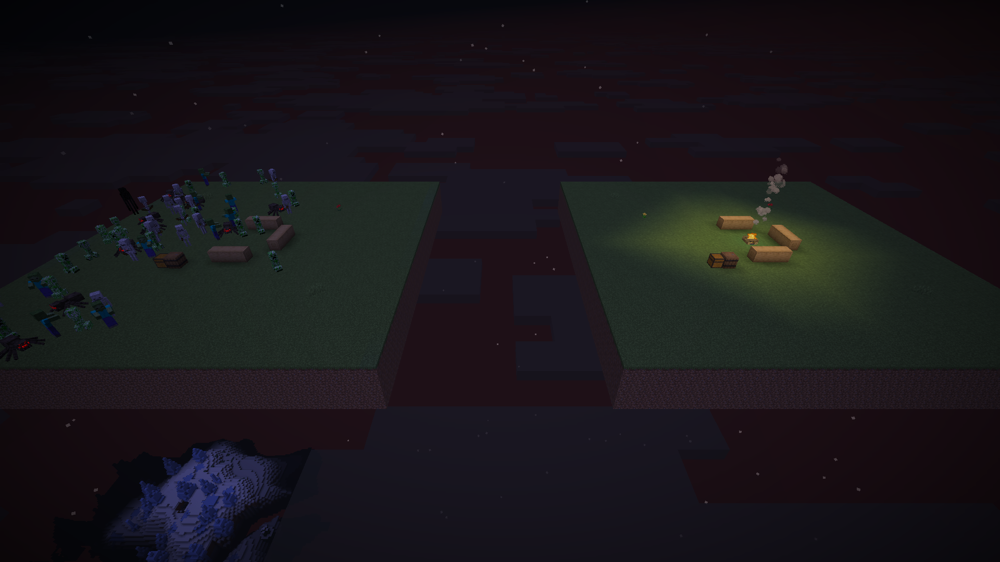

# MCNesclick

{ align=right width="128" }

Une collection de petits ajouts de survie dans l'esprit vanilla : le genre de choses qui vous manquaient sans que vous
le sachiez, jusqu'à ce que vous les essayiez. Tout se règle dans un seul fichier de config. Pour Fabric, NeoForge et
Forge, de Minecraft 1.18 à 26.3.

## En bref

- **[Pomme cuite](apples.md#pomme-cuite)** : faites cuire une pomme au four, au fumoir ou sur un feu de camp. 8 de faim
  et 12 de saturation au lieu de 4 et 2,4.
- **[Pommes d'émeraude et de diamant](apples.md#pommes-demeraude-et-de-diamant)** : fabriquées l'une après l'autre, à
  partir d'une pomme dorée. Héros du village et Chance avant de commercer, Célérité II et Vision nocturne avant de
  miner.
- **[Pommes des feuilles](apples.md#pommes-des-feuilles)** : choisissez la fréquence des pommes sur les feuilles de chêne
  et de chêne noir, et laissez toutes les autres feuilles en donner aussi.
- **[Feu de camp protecteur](campfire-protection.md)** : un feu de camp allumé empêche les monstres d'apparaître
  naturellement autour de lui, 16 blocs autour et 8 au-dessus et en dessous par défaut.
- **[Configurable](config.md)** : chaque fonctionnalité se règle ou se désactive, et chaque recette peut être remplacée
  par un datapack, KubeJS ou CraftTweaker.

## Pour aller plus loin

- [Pommes](apples.md) : les pommes cuite, d'émeraude et de diamant, et les pommes des feuilles.
- [Feu de camp protecteur](campfire-protection.md) : la zone protégée, et ce qu'elle bloque.
- [Configuration](config.md) : toutes les options avec leur valeur par défaut, les effets, et des notes pour les
  créateurs de modpacks.

## Prérequis

Nécessaire **sur le client et sur le serveur** : il ajoute des objets. Téléchargez le fichier qui correspond à votre
loader et à votre version de Minecraft.

| Loader | Versions de Minecraft |
|---|---|
| Fabric (**Fabric API obligatoire**) | toutes les versions de 1.18 à 26.3 |
| NeoForge | 1.20.4, 1.20.6, 1.21, 1.21.1, 1.21.3 à 1.21.11, 26.1, 26.1.1, 26.1.2, 26.2, 26.3 |
| Forge | 1.18.2, 1.19.2, 1.20.1, 1.21.1, 1.21.3 à 1.21.11, 26.1, 26.1.1, 26.1.2, 26.2, 26.3 |

## Langues

Anglais, français (France, Canada), allemand, espagnol (Espagne, Mexique), italien, néerlandais, polonais, portugais
(Brésil), russe, ukrainien, turc, chinois (simplifié, traditionnel), japonais et coréen.

## Téléchargement

[CurseForge](https://www.curseforge.com/minecraft/mc-mods/mcnesclick) ·
[Signaler un bug](https://github.com/MrNesClick/MrNesClick-Mods/issues/new?template=2-mcnesclick-bug.yml)
