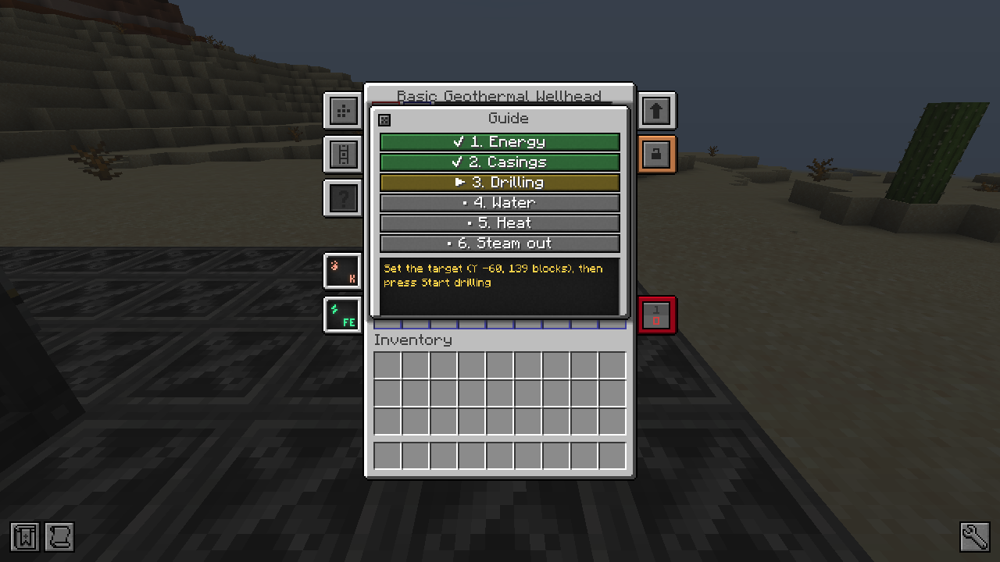
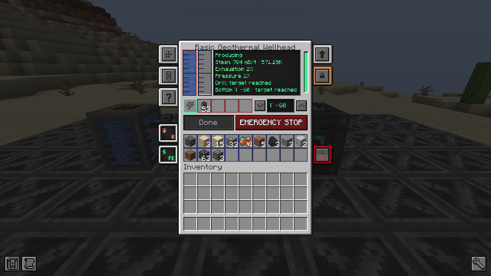

# Getting started

From a new wellhead to steam in a Mekanism turbine. The wellhead's own **Guide** (the **?** tab of its interface) walks
you through the same steps and opens by itself until the well first produced steam.

## 1. Craft

| Item | Recipe |
|---|---|
| **Steel Well Casing** ×8 | 4 steel ingots in a diamond: `_S_` / `S_S` / `_S_` |
| **Basic Geothermal Wellhead** | `SCS` / `AMA` / `SDS`: S steel ingot, C basic control circuit, A infused alloy, M Mekanism Steel Casing, D diamond |
| **Geothermal Logic Adapter** (optional) | `SRS` / `RCR` / `SQS`: S steel ingot, R redstone, C basic control circuit, Q comparator |

The recipes use common tags (`c:ingots/steel`, `c:circuits/basic`, `mekanism:alloys/infused`...), so steel and circuits
from other mods work too, and a datapack can replace them.

The column takes **one casing per drilled block**: a wellhead at sea level (Y 63) drilled to Y −60 needs about
124 casings, that is 62 steel ingots.

## 2. Place and power it

Place the wellhead where you want the well: it drills straight down, under itself. Leave **air above it**: the top face
is the safety valve.

By default, **every face but the top** accepts energy, water and casings, and outputs steam and debris. Steam is
auto-ejected, debris is not. Change it in Mekanism's side configuration tab, or with a Configurator, like any Mekanism
machine.

Connect **energy** (Universal Cable or any FE source): drilling costs 4,000 FE per block, and the control system
20 FE/t once the column exists. The buffer holds 400,000 FE.

## 3. Casings and drilling

1. Put **Steel Well Casings** in the casing slots (4 slots of 64), or feed them with a pipe or a hopper.
2. Set the **target depth** with the arrows next to the Y value (Shift: ±10, or the mouse wheel). The target is an
   absolute Y; the screen shows the blocks left and the casings needed.
3. Press **Start drilling**. The drill goes down one block every 2 seconds, takes one casing per block, puts what it
   digs in the debris slots, and stops at the target or when it meets lava.

Changing the target stops the drilling until you press the button again. A damaged column is repaired automatically,
without the button.

## 4. Water

Pipe **water** in (Mekanism Electric Pump, any water source that pushes fluid). A well uses a little more water than
the steam it makes: 5 % is lost as blowdown.

## 5. Heat

Steam needs heat, and heat depends on **how deep the bottom of the well is**. In the Overworld, the temperature is
100 °C at Y 0 and above (no steam: water only boils above it) and rises to **250 °C at Y −60**, where the well makes
its full **400 mB/t**. Lava within 2 blocks of the bottom adds 2 °C per source block, up to 50 °C: it helps a
shallower well reach full output (the output itself stays capped at the tier's rate by default).

| Bottom of the well | Temperature | Steam (Basic, no upgrade) |
|---|---|---|
| Y 0 and above | 100 °C | none |
| Y −30 | 175 °C | 200 mB/t |
| Y −60 and below | 250 °C | 400 mB/t |

The Nether is 180 °C at any depth but produces less (×0.6); the End has no usable heat.

## 6. Steam out

Connect a **Pressurized Tube** to a Mekanism **Industrial Turbine** (Mekanism Generators), a Chemical Tank or any
machine that takes Mekanism steam. The steam is auto-ejected through every face but the top.

If the steam has nowhere to go, the pressure rises: the valve vents above 80 % and the control system stops production
at 90 %. See [Safety](safety.md).

