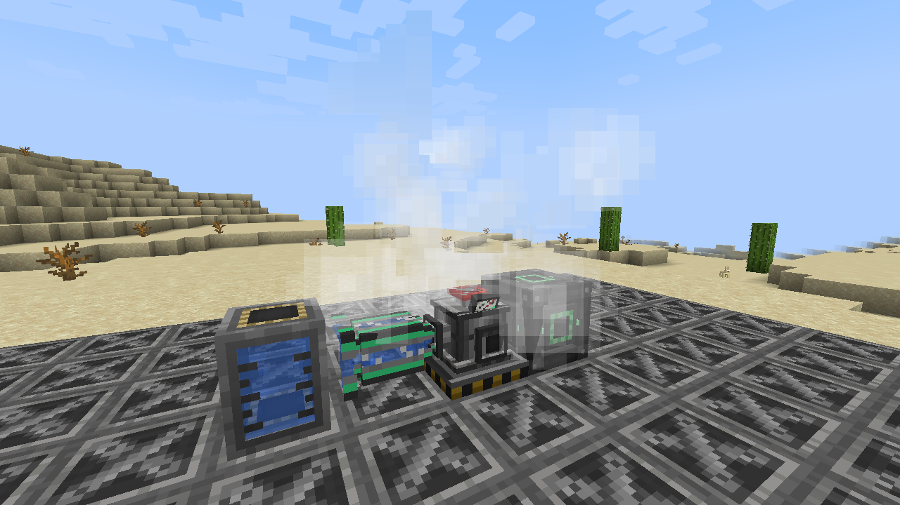
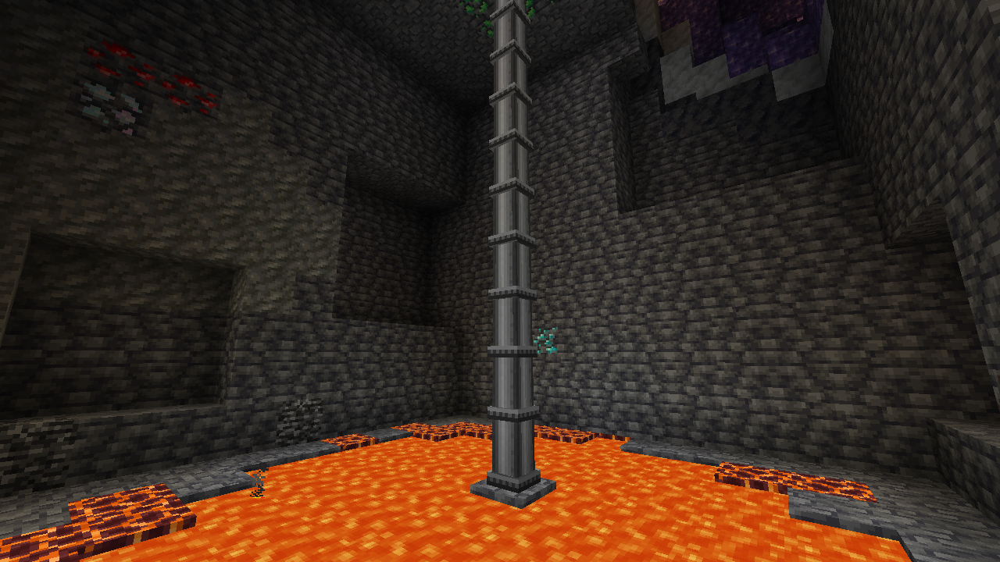

# Mekanistic Geothermal

{ align=right width="128" }

An addon for **[Mekanism](https://www.curseforge.com/minecraft/mc-mods/mekanism)**: a geothermal wellhead that drills its
own well and turns water into steam with the heat of the depths, for Mekanism's turbines.

!!! warning "Alpha"
    Playable, but expect bugs and balance changes. Back up your world before updating, and please
    [report what you find](https://github.com/MrNesClick/MrNesClick-Mods/issues/new/choose).

## In short

- **It drills its own well.** Put Steel Well Casings in its slots, set the target depth and press *Start drilling*: it
  goes down one block at a time, one casing per block, and stops at the target or on lava.
- **Deeper is hotter.** Heat grows with depth, and lava near the bottom adds to it. A deep Basic well makes about
  **400 mB/t** of Mekanism steam: well above passive generators, well below a fission reactor.
- **A real Mekanism machine.** Its interface, side configuration and auto-eject, Configurator, Speed and Energy upgrades,
  redstone control and security are Mekanism's own.
- **Safe by default.** A mechanical valve vents above 80 % pressure, the control system stops production at 90 % and
  when the water runs out, and an emergency stop halts everything. Eruptions are off by default.
- **Everything is configurable**, mild by default and harder if your modpack wants it.

## Where to go next

- [Getting started](getting-started.md): from the recipe to steam in a turbine, step by step.
- [Configuration](config.md): every option, with its default.

## Requirements

| Minecraft | Loader | Mekanism | Optional |
|---|---|---|---|
| 1.21.1 | NeoForge 21.1.194+ | 10.7.19+ | Mekanism Generators (its Industrial Turbine turns the steam into energy) |

## Download

[CurseForge](https://www.curseforge.com/minecraft/mc-mods/mekanistic-geothermal) ·
[Report a bug](https://github.com/MrNesClick/MrNesClick-Mods/issues/new?template=3-mekanistic-geothermal-bug.yml)
