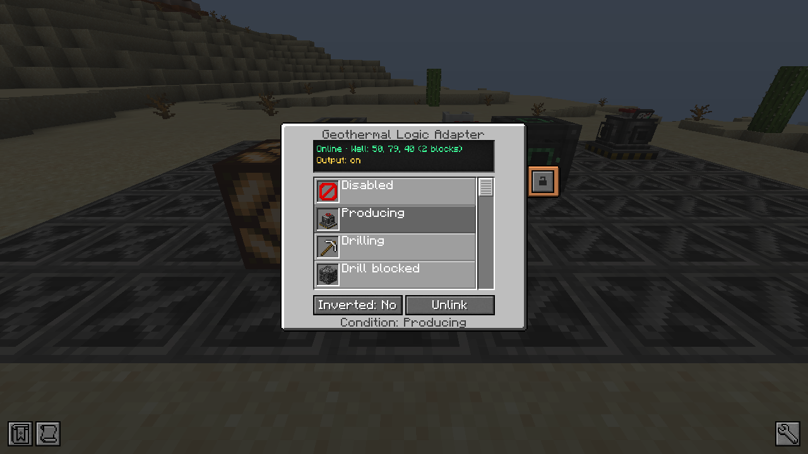

# Geothermal Logic Adapter

A redstone output for **one condition** of a linked well, or a redstone input that engages its emergency stop.

## Linking

- **Place it against a wellhead**: it links itself.
- Or, from further away (same dimension, up to 64 blocks by default): right-click the wellhead with a Mekanism
  **Configurator**, then the adapter. Sneak + right-click unlinks.

The adapter is **offline**, with no signal, while the chunk of its well is not loaded. Its screen shows the link
(online, offline, no wellhead, too far, not linked), the well's pressure, steam rate and state, and the output.

## Conditions

Pick the condition in the adapter's list; **Inverted** gives a signal when the condition is false.

| Condition | Signal while |
|---|---|
| Disabled | never (no output) |
| Producing | the well produces steam |
| Drilling | the drill works (drilling or repairing) |
| Drill blocked | the drill waits: energy, casings, full debris, lava, forbidden or protected block |
| Target reached | the drill has reached the target depth |
| High pressure | the pressure is at or above the valve threshold (80 %) |
| Valve venting | the safety valve vents steam |
| Valve obstructed | a block on top of the wellhead keeps the valve from venting |
| Automatic shutdown | the high-pressure shutdown holds production |
| Low water | production waits for water |
| Low energy | the control system or the drill lacks energy |
| Column damaged | a casing is missing in the column |
| Debris full | the debris inventory is full |
| No casings | the drill has no casings left |
| Emergency stop | the emergency stop is engaged |
| Emergency stop input | no output: a redstone signal on the adapter engages the emergency stop of the well |

In input mode, the emergency stop engages on the rising edge of the signal; resetting the well while the signal stays
on does not engage it again.

## Security

The adapter uses Mekanism's security, like the wellhead: only its owner and trusted players (or everyone, if public)
open it or link it.
