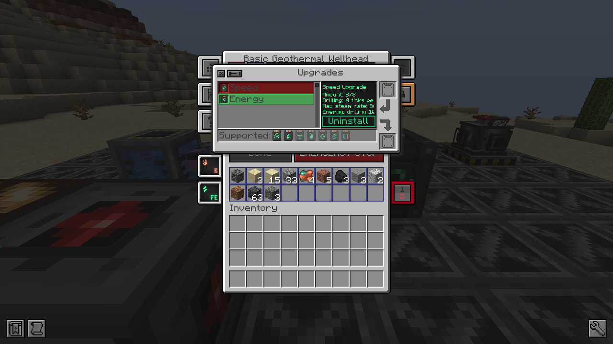

# Améliorations

La tête de puits accepte les **mises à niveau de la vitesse** et les **mises à niveau énergétiques** de Mekanism,
jusqu'à 8 de chaque, dans l'onglet des améliorations de Mekanism ou avec un clic droit accroupi sur la tête de puits.
Comme sur les machines de Mekanism, un multiplicateur M s'applique en M^(n/8) avec n améliorations.

## Vitesse

- **Forage** : ×10 plus rapide avec 8 améliorations (4 ticks par bloc au lieu de 40).
- **Vapeur** : le débit de vapeur max double avec 8 améliorations (800 mB/t pour le tier basique). La consommation
  d'eau suit.
- **Le prix, comme dans Mekanism** : l'énergie par tick augmente avec le carré de la vitesse. L'énergie de forage par
  tick est ×100 avec 8 améliorations (la même énergie par bloc, dix fois plus vite), celle du système de contrôle ×4.
  La vapeur en plus compte aussi dans la charge d'[épuisement](wellhead.md#epuisement) : deux fois plus de vapeur,
  deux fois plus d'usure.

## Énergie

- Énergie de forage et du système de contrôle ÷10 avec 8 améliorations.
- Réserve d'énergie ×10 (4 000 000 FE pour le tier basique).

## Les deux

8 de vitesse et 8 d'énergie : 4 ticks et 4 000 FE par bloc, 800 mB/t de vapeur, 8 FE/t pour le système de contrôle.

Tous les multiplicateurs, et le fait que la vitesse agisse ou non sur la vapeur et le système de contrôle, sont dans la
[section `[upgrades]`](config.md#upgrades) de la config.
