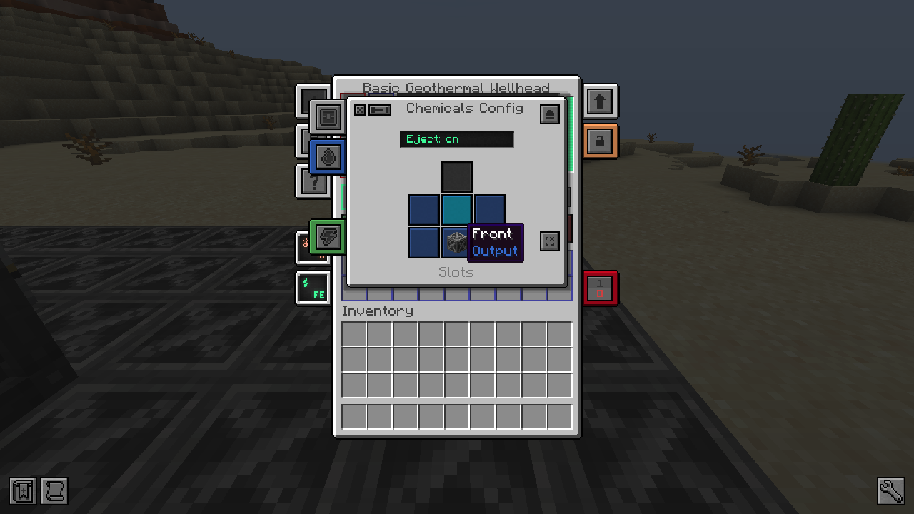

# La tête de puits

La **tête de puits géothermique basique** est une machine Mekanism : elle repose sur le framework de machines de
Mekanism, donc son interface, ses onglets, sa configuration des faces, l'éjection automatique, les modes du
Configurateur, les améliorations, le contrôle redstone, la sécurité et l'affichage Jade fonctionnent comme sur les
machines de Mekanism.

## L'interface

- **Jauges** : eau (à gauche) et vapeur (à droite), et la barre d'énergie.
- **Écran d'état** : production, débit de vapeur et température, épuisement, pression (et la soupape quand elle évacue
  ou ne peut pas), état et progression du forage, profondeur. Survolez-le pour les détails : débit max du tier, système
  de contrôle, interférence, besoin en eau.
- **Emplacements de tubage**, **profondeur cible** (flèches, Maj : ±10, molette), boutons **Démarrer le forage** et
  **Arrêt d'urgence**, et les emplacements de **déblais**.
- **Onglets** : configuration des faces, transporteur, améliorations, sécurité et contrôle redstone de Mekanism, plus
  le **guide** et les onglets de chaleur et d'énergie.

## Le forage

- La foreuse descend d'un bloc à la fois sous la tête de puits (40 ticks et 4 000 FE par bloc par défaut) et pose un
  tubage de puits en acier dans chaque trou. Chaque bloc creusé va dans les emplacements de déblais ; videz-les à la
  main ou par une face de sortie d'objets.
- Elle s'arrête à la **profondeur cible**, ou quand elle rencontre de la **lave** : la lave chauffe alors le puits
  (l'étape de forage du guide compte comme faite).
- Elle attend, et dit pourquoi, quand elle manque d'énergie ou de tubages, quand les déblais sont pleins, ou devant un
  bloc qu'elle ne peut pas casser (incassable, interdit, ou protégé par un claim : la foreuse agit avec les permissions
  de son propriétaire).
- **Grottes** : chaque bloc d'air traversé prend un tubage et l'énergie d'un bloc foré, pour que la colonne reste
  continue.
- **Réparations** : si un tubage de la colonne est retiré, la tête de puits le remet d'elle-même (sans bouton). Tant
  qu'un tubage manque, le puits ne produit pas de vapeur.

## Chaleur et vapeur

La température d'un puits dépend du **Y absolu de son fond** et de la dimension :

| Dimension | Température | Multiplicateur de production |
|---|---|---|
| Overworld | 100 °C à Y 0 et au-dessus, puis une hausse linéaire jusqu'à 250 °C à Y −60 | ×1 |
| Nether | 180 °C à toute profondeur | ×0,6 |
| End | pas de vapeur | — |

L'eau bout au-dessus de 100 °C : le **facteur de température** va de 0 à 100 °C à 1 à 250 °C. Les blocs de source de
lave à 2 blocs ou moins du fond ajoutent 2 °C chacun, jusqu'à 50 °C.

**Débit de vapeur** = débit max (400 mB/t pour le tier basique, ×2 avec 8 mises à niveau de vitesse) × facteur de
température × (1 − interférence) × (1 − épuisement), limité par l'eau disponible. La tête de puits consomme 1/0,95 mB
d'eau par mB de vapeur (5 % de purge). L'ébullition est passive : elle ne demande pas d'énergie (l'énergie n'alimente
que la foreuse et le système de contrôle).

| Source | Vapeur | Meilleure énergie via une turbine Mekanism |
|---|---|---|
| Puits basique à Y −60, seul et neuf | 400 mB/t | 1 600 FE/t |
| Puits basique à Y −30 | 200 mB/t | 800 FE/t |
| Puits basique dans le Nether | 128 mB/t | 512 FE/t |
| Plus petit réacteur à fission de Mekanism (combustion de 0,1 mB/t) | 2 000 mB/t | 8 000 FE/t |

## Interférence

Des puits trop proches se partagent la chaleur. Chaque voisin qui **a produit dans les 3 dernières secondes** à moins
de **24 blocs** coûte 25 % × (1 − distance / 24) : deux puits côte à côte perdent jusqu'à 25 % chacun, des puits à
24 blocs l'un de l'autre ne perdent rien. Le total est plafonné à 75 % et recalculé toutes les 5 secondes. Survolez
l'écran d'état pour le voir.

## Épuisement

Une colonne **s'épuise** lentement sous forte charge et **se rétablit au repos**. L'épuisement s'affiche sur l'écran
principal, coloré comme les dégâts du réacteur à fission de Mekanism (vert, jaune, orange, rouge foncé par quarts du
maximum).

- À pleine charge, il augmente de 1 % du débit par jour Minecraft, jusqu'à **15 %** (environ 15 jours de production
  continue, 7,5 avec 8 mises à niveau de vitesse : la vapeur en plus compte dans la charge).
- Au repos, il se résorbe de 5 % par jour. Un puits sous 83 % du débit de son tier ne s'use jamais.
- Il appartient à la **colonne**, pas à la tête de puits : casser et remplacer la tête ne le remet pas à zéro, et un
  puits déchargé se rétablit pendant votre absence.

## Démontage

Comme les machines de Mekanism, une tête de puits cassée garde dans l'objet son énergie, son eau, ses améliorations,
ses tubages, ses déblais, ses réglages, sa configuration des faces et son mode redstone ; la vapeur est relâchée. Les tubages restent
dans le sol : une nouvelle tête de puits posée sur la colonne la reprend sans reforer.
